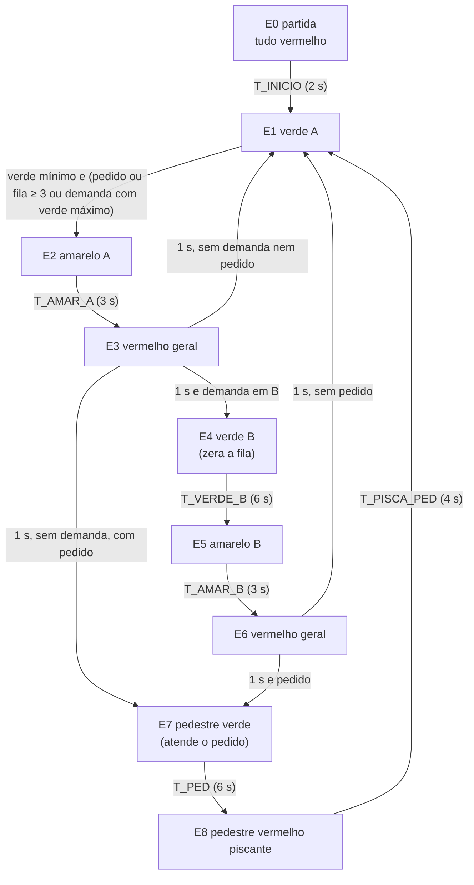

# Tema 1 — Semáforo inteligente

**Projeto A3 — Sistemas Automatizados (USJT 2026.2).** Núcleo técnico do tema:
problema, sensores e atuadores, modelo de estados, programa Ladder no PLC
Simulator Online e validação no motor nativo do simulador. 
**Estado:** programa construído e validado no motor nativo do simulador — 90/90 casos com esperado escrito antes da execução, 32 683/32 683 registros de varredura idênticos ao interpretador independente, 8/8 invariantes sem violação, 6/6 mutantes reprovados, 9 capturas conferidas; link público conferido sem sessão em 12/10/2026; relatório ABNT e apresentação gerados 
**Data:** especificação e programa em 12 de outubro de 2026; execução nativa às 05:13 UTC (02:13 em Brasília), capturas às 05:15 UTC, verificação final às 05:15 UTC

## Link e documentos

- **Programa no PLC Simulator Online:** <https://app.plcsimulator.online/wuPLOb3XvySEne6i8krQ> — abre sem login, com as
  entradas em 0 e o semáforo pronto para a partida ao ligar a simulação.
  Conferido em 12/10/2026, num contexto de navegador sem cookies nem sessão:
  estrutura, comentários dos rungs e valores das tags idênticos ao arquivo
  [`plc-simulator/semaforo.json`](plc-simulator/semaforo.json); o documento
  gravado no banco do simulador também é idêntico ao arquivo. Um link é um
  retrato gravado no momento do compartilhamento e não acompanha edições
  posteriores.
  Titularidade confirmada em 12/10/2026, por comparação com a conta
  autenticada no navegador.
- **Relatório técnico (ABNT):** [`documentos/relatorio.pdf`](documentos/relatorio.pdf)
  (20 páginas) e a versão editável [`documentos/relatorio.docx`](documentos/relatorio.docx).
- **Apresentação (10–15 min):** [`documentos/apresentacao.pptx`](documentos/apresentacao.pptx)
  (13 slides, com anotações do apresentador) e
  [`documentos/apresentacao.pdf`](documentos/apresentacao.pdf).
- Os documentos estão marcados como **versão preliminar** até o grupo ser
  definido; são gerados por `Entregas/A3/documentos/gera.mjs` a partir do
  conteúdo em `Entregas/A3/documentos/temas/01-semaforo.mjs`.

## Problema

Um cruzamento entre uma **via principal A** e uma **via secundária B**, com
travessia de pedestres. O controlador precisa alternar os fluxos sem que dois
fluxos conflitantes fiquem abertos ao mesmo tempo, abrir a via B só quando há
veículo esperando, atender o botão de pedestre e oferecer um modo de amarelo
intermitente para manutenção ou falha.

O "inteligente" está em três decisões tomadas pelo próprio controlador:

- **Atuação por demanda:** sem veículo em B e sem pedestre, a via A fica verde
  indefinidamente; ninguém espera um ciclo vazio.
- **Fila contada:** um laço detector conta os veículos que chegam com B
  fechada. Com três ou mais, B é atendida assim que o verde mínimo de A termina;
  um veículo sozinho espera o verde máximo de A.
- **Pedido memorizado:** um toque no botão basta; a lâmpada "aguarde" confirma
  o registro até a travessia começar.

## Sensores, atuadores e tags

| Tag | Tipo | Função | Valor inicial |
|---|---|---|---|
| `DET_B` | entrada | laço detector na faixa de retenção da via B (1 = veículo sobre o laço) | 0 |
| `BT_PED` | entrada | botoeira de pedestre (1 enquanto pressionada) | 0 |
| `MANUT` | entrada | chave de manutenção/falha: 1 = amarelo intermitente | 0 |
| `A_VERDE`, `A_AMARELO`, `A_VERMELHO` | saídas | grupo focal da via A | 0 |
| `B_VERDE`, `B_AMARELO`, `B_VERMELHO` | saídas | grupo focal da via B | 0 |
| `PED_VERDE`, `PED_VERMELHO` | saídas | grupo focal de pedestres | 0 |
| `PED_AGUARDE` | saída | lâmpada "aguarde" da botoeira | 0 |
| `E0_INICIO` … `E8_PED_PISCA` | internas | etapas do GRAFCET (memórias SET/RESET) | 0 |
| `INIT` | interna | partida já feita | 0 |
| `SOL_PED` | interna | pedido de pedestre memorizado | 0 |
| `C_FILA` | contador CTU | veículos esperando em B (PV = 3) | CV = 0 |
| `DEM_B` | interna | há veículo esperando em B (`C_FILA.CV ≥ 1`) | 0 |
| `TR01` … `TR81` | internas | transições disparadas nesta varredura | 0 |
| `HAB_PISCA`, `FASE`, `LUZ_PISCA` | internas | gerador de intermitência | 0 |

Tempos (reduzidos para a demonstração; o simulador conta o tempo em
varreduras de 66 ms):

| Temporizador | PT | Varreduras | Ordem de grandeza real |
|---|---:|---:|---|
| `T_INICIO` vermelho geral na partida | 2 s | 31 | alguns segundos |
| `T_MIN_A` verde mínimo de A | 8 s | 122 | dezenas de segundos |
| `T_MAX_A` verde máximo de A | 16 s | 243 | um a dois minutos |
| `T_AMAR_A`, `T_AMAR_B` amarelo | 3 s | 46 | alguns segundos |
| `T_TV_A`, `T_TV_B` vermelho geral | 1 s | 16 | um a três segundos |
| `T_VERDE_B` verde de B | 6 s | 91 | dezenas de segundos |
| `T_PED` verde de pedestre | 6 s | 91 | dezenas de segundos |
| `T_PISCA_PED` vermelho piscante | 4 s | 61 | alguns segundos |
| `T_LUZ`, `T_APAG` meia-onda | 0,5 s | 8 | meio segundo |

As ordens de grandeza reais servem só para a discussão; nenhuma norma de
trânsito foi consultada.

## Modelo de estados (GRAFCET)

Fora do GRAFCET: `MANUT = 1` zera todas as etapas e liga o amarelo
intermitente nas duas vias; ao voltar a 0, o programa recomeça por E0.

| Etapa | A | B | Pedestre |
|---|---|---|---|
| E0, E3, E6 | vermelho | vermelho | vermelho |
| E1 | **verde** | vermelho | vermelho |
| E2 | **amarelo** | vermelho | vermelho |
| E4 | vermelho | **verde** | vermelho |
| E5 | vermelho | **amarelo** | vermelho |
| E7 | vermelho | vermelho | **verde** |
| E8 | vermelho | vermelho | vermelho **piscando** |
| manutenção | amarelo piscando | amarelo piscando | apagado |

## Programa Ladder

Arquivo: [`plc-simulator/semaforo.json`](plc-simulator/semaforo.json), no
formato nativo do simulador, com o comentário de cada rung. São 55 rungs, 180 elementos, 6 ramos e 121 tags (contando as sub-tags de temporizadores e contador).

O programa segue a conversão de GRAFCET para Ladder usada nas TPs: primeiro
todas as transições são calculadas a partir das etapas do início da varredura;
depois cada transição disparada desliga a etapa de origem e liga a de
destino; depois os temporizadores; por fim as saídas, cada lâmpada escrita em
uma única bobina. Assim nenhuma etapa é pulada numa mesma varredura.

| Bloco | Rungs | O que faz |
|---|---|---|
| Fila e pedidos | F1–F4 | `C_FILA.R = E4`; CTU `C_FILA` na borda de `DET_B · ¬E4_VERDE_B`; `DEM_B = C_FILA.CV ≥ 1`; SET de `SOL_PED` com `BT_PED · ¬E7 · ¬MANUT` |
| Transições | T01–T81 | `TRxy = Ex · tempo da etapa · condição` (12 transições) |
| Disparo | S01–S81, SP, MN | `TRxy` → RESET da origem, SET do destino; E7 atende o pedido; `MANUT` zera etapas, `INIT` e pedido |
| Temporizadores | TM0–TM9 | um TON por etapa temporizada (E1 tem dois: mínimo e máximo) |
| Intermitência | P1–P5 | `HAB_PISCA = MANUT + E8`; dois TON de 0,5 s com a fase guardada em `FASE`; `LUZ_PISCA` acende primeiro |
| Lâmpadas | O1–O9 | `A_VERMELHO = ¬MANUT·¬E1·¬E2` (vermelho por padrão); amarelos com o OU da manutenção; `PED_VERMELHO = ¬MANUT·¬E7·¬E8 + E8·LUZ_PISCA` |
| Partida | IN (último) | `¬INIT · ¬MANUT` → SET `E0_INICIO`, SET `INIT` |

## Decisões de projeto

| Decisão | Por quê |
|---|---|
| Fase exclusiva de pedestres | todos os veículos parados durante a travessia: um só grupo focal de pedestres e nenhum conflito a analisar |
| Vermelho escrito como "nem verde nem amarelo" | qualquer varredura sem etapa ativa mostra vermelho — por exemplo, a de inicialização (S00) e a de saída da manutenção (M04) |
| Fila contada na borda de `DET_B · ¬E4` | um veículo parado sobre o laço quando o verde de B termina volta a ser contado (a energia do contador sobe de novo) — o mutante MUT-S3 mostra o veículo esquecido |
| Pedido registrado antes das transições | um pedido feito depois do verde mínimo encerra o verde A na mesma varredura |
| `SOL_PED` atendido depois do disparo | a lâmpada "aguarde" apaga na mesma varredura em que o pedestre recebe verde |
| B tem prioridade sobre o pedestre na saída do vermelho geral | quem espera em B é atendido primeiro; o pedestre vem logo depois, sem voltar ao verde A |
| Manutenção zera etapas e recomeça pela partida | sair da manutenção sempre passa pelo vermelho geral, nunca direto a um verde |

## Validação

**Método.** O mesmo das TPs 06 e 07, descrito na visão geral do projeto:

1. **Esperado escrito antes da execução**, a partir da especificação e das
   regras do motor (66 ms por varredura; TON com Q na varredura ⌈PT/66⌉;
   contador por borda com reset dominante; varredura de parada). A única
   tabela calculada é a da intermitência, por fórmula escrita na
   especificação.
2. **Motor nativo do simulador:** o programa é importado pela ação interna da
   aplicação, as entradas são escritas pela ação que muda o valor de uma tag e
   cada varredura liga a simulação, executa um ciclo e desliga. Depois de cada
   varredura são lidas todas as tags observadas.
3. **Conferência independente:** um interpretador próprio, em Python, executa o
   mesmo JSON e precisa coincidir com o motor em todos os registros de varredura
   (cada um com todas as tags observadas depois de uma varredura).
4. **Invariantes** de segurança vigiados em toda varredura com a simulação
   ligada; **mutantes** (programas com um defeito proposital) precisam
   reprovar onde devem.

| Grupo | Casos | Varreduras | Resultado |
|---|---:|---:|---:|
| partida e repouso | 4 | 433 | 4/4 |
| pedestre (pedido, travessia, botão durante a travessia, botão preso) | 43 | 1 963 | 43/43 |
| via B (fila, um veículo, veículo sobre o laço) | 30 | 1 038 | 30/30 |
| manutenção (amarelo intermitente) | 9 | 107 | 9/9 |
| parada e retomada da simulação | 4 | 48 | 4/4 |
| **total** | **90** | | **90/90** |

As varreduras da tabela somam só os casos; com os passos de preparo (também
conferidos), são 4 669 por execução do programa. O motor nativo e o
interpretador coincidiram em **32 683 de 32 683 registros de varredura** (programa e seis
mutantes). O registro completo está em
[`casos_teste.csv`](casos_teste.csv), [`testes/casos-de-teste.md`](testes/casos-de-teste.md),
[`testes/traco-pisca-pedestre.csv`](testes/traco-pisca-pedestre.csv) (as 61
varreduras do vermelho piscante) e [`testes/resultados.json`](testes/resultados.json)
(SHA-256 do programa, dos casos, dos mutantes, das ferramentas e das capturas).

| Invariante | Descrição | Violações |
|---|---|---:|
| INV-S1 | fora da manutenção, A e B nunca abertos (verde ou amarelo) ao mesmo tempo | 0 |
| INV-S2 | pedestre verde só com A e B vermelhos | 0 |
| INV-S3 | fora da manutenção, exatamente uma etapa ativa; em manutenção, nenhuma | 0 |
| INV-S4 | cada grupo veicular com exatamente uma lâmpada; pedestre nunca verde e vermelho juntos | 0 |
| INV-S5 | um verde nunca vai direto a vermelho | 0 |
| INV-S6 | um verde só começa com as outras correntes fechadas na varredura anterior | 0 |
| INV-S7 | em manutenção: só os amarelos, piscando juntos | 0 |
| INV-S8 | "aguarde" = pedido registrado; demanda = fila ≥ 1 | 0 |

Os invariantes foram vigiados em 4 668 varreduras (todas com a simulação
ligada; a única varredura de parada fica fora).

| Mutante | Defeito introduzido | Deve reprovar em | Resultado |
|---|---|---|---|
| MUT-S1 | `A_AMARELO` escrito em duas bobinas | P03 | reprovou em 12 casos; INV-S4 e INV-S5 violados |
| MUT-S2 | transições usam o botão direto, sem memória do pedido | P03 | reprovou em 21 casos |
| MUT-S3 | fila contada só pela borda do laço | L04 | reprovou em L04–L08: o veículo parado sobre o laço é esquecido |
| MUT-S4 | vermelhos sem `¬MANUT` | M01 | reprovou em 4 casos; INV-S7 violado |
| MUT-S5 | sem verde mínimo de A | P01 | reprovou em 56 casos |
| MUT-S6 | sem verde máximo de A | U04 | reprovou em U04–U06 e L08: um veículo sozinho nunca é atendido |

**Histórico.** Uma única execução nativa, aprovada por inteiro. Antes dela,
na revisão dos esperados, um caso do botão preso foi corrigido no papel: na
primeira varredura do vermelho piscante o pedido ainda é lido com a etapa de
pedestre ativa (o pedido é registrado antes das transições), e por isso só é
registrado na segunda varredura (Q05–Q06).

Depois da revisão independente, a terminologia foi padronizada ("registros de
varredura": cada registro reúne todas as tags observadas depois de uma
varredura) e o relatório de testes foi regenerado às 07:05 UTC com o verificador
atualizado. A execução nativa, o programa e os casos são os mesmos (mesmo
SHA-256); os resultados não mudaram.

## Capturas

Cada captura foi tirada no estado alcançado pelos mesmos passos dos casos de
teste, com o relógio de varredura da interface suspenso durante a foto; só foi
gravada depois de conferir que o estado ficou estável, que a tabela de tags
exibida é igual ao estado do simulador e que as tags decisivas têm os valores
do caso. Anúncios da página foram ocultados por CSS local. A tabela à
esquerda mostra as tags booleanas; no diagrama, verde indica a condição
verdadeira daquele contato ou bobina.

| Arquivo | Estado | Caso |
|---|---|---|
| [`01-partida-vermelho-geral.png`](evidencias/01-partida-vermelho-geral.png) | partida: tudo vermelho | S01 |
| [`02-verde-a-pedido.png`](evidencias/02-verde-a-pedido.png) | verde A com pedido registrado ("aguarde" aceso) | P01 |
| [`03-amarelo-a.png`](evidencias/03-amarelo-a.png) | amarelo A | P03 |
| [`04-vermelho-geral.png`](evidencias/04-vermelho-geral.png) | vermelho geral entre fases | P05 |
| [`05-pedestre-verde.png`](evidencias/05-pedestre-verde.png) | travessia: pedestre verde, veículos vermelhos | P07 |
| [`06-pedestre-piscando.png`](evidencias/06-pedestre-piscando.png) | vermelho piscante de pedestre (meia-onda acesa) | P09, 20ª varredura |
| [`07-fila-cheia.png`](evidencias/07-fila-cheia.png) | contador da fila em 3 durante o verde A | F06 |
| [`08-verde-b.png`](evidencias/08-verde-b.png) | verde B, fila zerada | F12 |
| [`09-manutencao.png`](evidencias/09-manutencao.png) | manutenção: amarelos acesos, vermelhos e pedestre apagados | M01 |

## Como reproduzir

1. **No simulador:** abra o link público (<https://app.plcsimulator.online/wuPLOb3XvySEne6i8krQ>) e ligue a simulação
   (último botão da barra de ferramentas). Com a simulação ligada, um clique num contato de entrada alterna a tag:
   - deixe rodar: vermelho geral por 2 s, depois verde A, que fica;
   - clique em `BT_PED` duas vezes (1 e 0): "aguarde" acende; depois do verde
     mínimo vêm amarelo, vermelho geral e a travessia;
   - alterne `DET_B` três vezes (1, 0, 1, 0, 1, 0): a fila chega a 3 e B abre
     no fim do verde mínimo;
   - ligue `MANUT`: os dois amarelos piscam; desligue: o semáforo recomeça.
2. **Testes:** no repositório de trabalho, `python gera.py 01-semaforo`,
   `node testa_nativo.mjs 01-semaforo` (Chrome de validação aberto) e
   `python verifica.py 01-semaforo`.

## Limitações

- Simulação lógica, sem hardware: o tempo é contado em varreduras de 66 ms e
  os tempos foram reduzidos para a demonstração.
- Fase exclusiva de pedestres: mais simples de analisar (todos os veículos
  parados durante a travessia), porém menos eficiente
  que travessias em paralelo com o fluxo de veículos.
- Não há detecção de lâmpada queimada: `MANUT` representa a chave manual ou o
  sinal de um supervisor externo.
- Parar e religar a simulação reinicia o tempo da etapa em curso (os
  temporizadores zeram; as etapas não).
- Com o botão de pedestre preso em 1, há travessia a cada ciclo — mas o verde
  mínimo de A é sempre cumprido.

## Fontes

Documento do projeto da A3 (especificação do professor, 07/10/2026); regras do
motor lidas no código do PLC Simulator Online e confirmadas pela caracterização
da plataforma (`00-plataforma`, 68/68). Normas de trânsito e de CLP não foram
consultadas.
